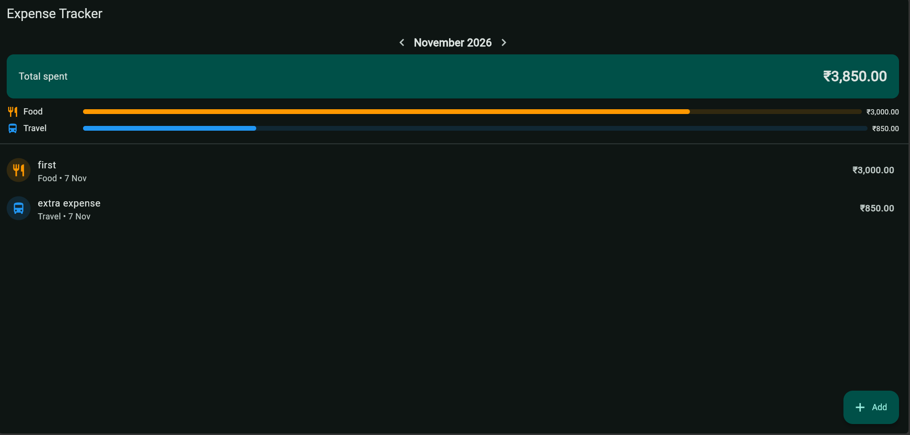
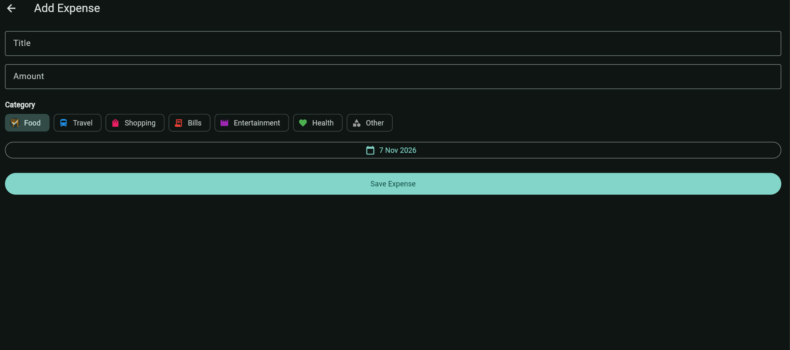

# Expense Tracker

A simple and clean Flutter app for tracking daily expenses. You can add expenses, sort them into categories and see how much you spent each month. All data is saved on the device, so nothing is lost when the app is closed or restarted.

## Features
- Add an expense with a title, amount, category and date
- 7 categories, each with its own icon and colour: Food, Travel, Shopping, Bills, Entertainment, Health, Other
- Monthly total shown at the top of the home screen
- Per-category breakdown with progress bars for the selected month
- Switch between months using the arrow buttons
- Delete an expense by swiping it left, with an UNDO option
- Input validation (a title and a valid amount are required)
- Light and dark mode that follow the system setting
- Data persistence: expenses are stored locally and reloaded on startup

## Screenshots
| Home | Add expense | 
|------|-------------|
|  |  |

## Demo
- APK: download from the **Actions** tab of this repo, open the latest run and get the **app-release** artifact

## How it works
- **Model:** `Expense` holds the id, title, amount, category and date, and can convert itself to and from JSON.
- **Storage:** `StorageService` saves the list of expenses as JSON text using `shared_preferences` and loads it when the app starts.
- **Home screen:** filters expenses by the selected month, calculates the total and the category totals, and handles add and delete.
- **Add screen:** a validated form that returns the new expense to the home screen.

## Tech stack
- Flutter and Dart
- shared_preferences (local storage)
- intl (date and currency formatting)

## Project structure
    lib/
    ├── main.dart
    ├── models/
    │   └── expense.dart
    ├── services/
    │   └── storage_service.dart
    ├── utils/
    │   ├── categories.dart
    │   └── format.dart
    ├── screens/
    │   ├── home_screen.dart
    │   └── add_expense_screen.dart
    └── widgets/
        ├── expense_tile.dart
        └── category_summary.dart

## Run locally
    git clone https://github.com/guneet-ag/expense-tracker.git
    cd expense-tracker
    flutter pub get
    flutter run

## Build the APK
    flutter build apk --release

The APK is created at `build/app/outputs/flutter-apk/app-release.apk`.